# 🚗 Araç Kiralama - Car Rental System (C# & SQL Server)

🇬🇧 **English** · 🇹🇷 [Türkçe](README.tr.md)

A Windows Forms application built with .NET 10 and SQL Server for a car rental company: customers sign up, browse
the cars, book a car for a range of days and cancel or return it; admins manage cars, accounts and every active
rental. A car can never be booked twice for the same day. The code is split into Domain, Business, Data and UI
layers; database access uses EF Core, and the database is created, migrated or upgraded automatically on startup.

> The application's user interface is in Turkish. Screen and button names below are given with their Turkish
> labels followed by an English translation, e.g. "Araç Ekle" (Add Car).

---

## 📦 Features

### Design and themes

- ✅ **Own visual identity**: asphalt graphite and signal orange, a road and location pin logo, headings, prices,
  plates and calendar days in Bahnschrift (the DIN-style road-sign face of Windows) and running text in Segoe UI.
  Common car models show a bundled photograph from Wikimedia Commons (see [Image credits](#image-credits)); any
  other car is drawn in code in its own colour.
- ✅ **Light, dark and high contrast**: `Appearance:Theme` chooses `Light` (default), `Dark` or `System` (follows the
  Windows app mode). High contrast always wins and uses the Windows system colours with native controls; selected
  and hovered items keep HighlightText. Open screens follow a change of high contrast or the app mode while the
  application runs.
- ✅ **One frame for every screen**: a header with what the screen is for, an inline message strip for results and
  refusals (no message window takes the focus; only questions ask in a themed window), the content and a footer with
  the actions. Windows fit their content, never open larger than the screen's working area and scroll their body on a
  small screen; the application is per-monitor DPI aware.

### Car catalog

- ✅ **Catalog** ("Araçlar", Cars): the listed cars as cards with picture, brand, model, plate, year, gearbox, fuel
  type, colour and daily price.
- ✅ **Filters** by brand ("Marka"), gearbox ("Vites Tipi") and fuel type ("Yakıt Tipi"); filling the filter lists never
  starts a load by itself, and only the answer to the latest filter is shown.
- ✅ **Car pictures**: twelve common models (Renault Clio, Fiat Egea, Toyota Corolla, Volkswagen Golf, Dacia Duster,
  Peugeot 2008, Tesla Model 3, Fiat 500, Ford Transit Custom, Volkswagen Touran, Mazda MX-5, Fiat Doblò) show a
  bundled photograph, matched by make and model ("Renault" + "Clio 1.0 TCe" matches the Clio). The photograph shows
  the model, not the car itself. A car's own picture address is loaded in the background from public http or https
  addresses only and replaces it; every other car shows the application's own drawing in its colour. Nothing is
  loaded from the web for the bundled photographs.

### Bookings, cancellations and returns

- ✅ **Book** ("Kirala", Rent → "Araç kirala", Book a Car): pick the start day ("Alış günü", Pick-up Day) and the
  number of days ("Gün sayısı"); the screen shows the return day and the total as they change and lists the days the
  car is already taken. "Kiralamayı Onayla" (Confirm Rental) shows the pick-up and return dates and the total and asks
  for confirmation. No payment is taken.
- ✅ **Days are half-open ranges**: a booking holds the pick-up day up to, but not including, the return day. A booking
  may start on the day another one ends; any shared day is refused, also when two customers book at the same moment.
- ✅ **Settings** (`Rental` section): shortest and longest rental (1 and 90 days by default), how far ahead a booking
  may start (365 days by default) and an optional long rental discount (off by default). A booking never starts in
  the past.
- ✅ **Price check**: when the daily price changes after the quote was shown, the booking is refused and nothing is
  written.
- ✅ **Cancel or return** from "Kiralamalarım" (My Rentals), which lists the account's own active rentals as cards with
  their stage ("Başlamadı", not started; "Devam ediyor", under way): before the pick-up day "Kiralamayı İptal Et" (Cancel Rental) frees every day; once the rental is
  under way "İade Al" (Take Back) returns the car today and frees the remaining days. Admins do the same for any
  rental in the rental panel. Rentals are never deleted; they keep their row with a new status.

### Admin panel

- ✅ **Cars** ("Yönetim paneli", Admin Panel): add ("Araç Ekle"), change ("Aracı Güncelle") and delete ("Aracı Sil")
  cars with brand, model, year, gearbox, fuel type, mileage, colour, plate, daily price and picture address ("Resim
  adresi"). Every invalid field gets a danger border and its message. Plates are unique. A car with rental history cannot be
  deleted; "Kiralamaya açık" (Open for rental) hides it from customers instead. A change from a form opened before
  another admin's change (a new price, the car taken off the list) is refused and the car is loaded again.
- ✅ **Accounts** ("Hesaplar"): add, change and delete accounts with role,
  e-mail and phone (masked in the list); a new password replaces the old one and lifts a lock. Admins and accounts
  with rentals cannot be deleted, and the last admin keeps the admin role. A change from a form opened before the
  account's role or password changed elsewhere is refused and the account is loaded again, so a stale form cannot give
  back a role another admin just removed. An admin who changes their own role or password is signed out.
- ✅ **Rentals** ("Kiralamalar"): every active rental with its renter, filterable by brand, gearbox and fuel type.

### Calendar, maintenance, reports and contracts

- ✅ **Availability calendar** ("Müsaitlik Takvimi"): a month of one car, every day marked "Boş" (free), "Dolu"
  (booked), "Bakım" (maintenance or damage repair) or "Geçmiş" (past), decided with the database's today, which also
  chooses the first month shown. Customers open it from the rental screen for listed cars and see every day before
  today as past; admins open it from the admin panel for any car and also see the past days of rentals and
  maintenance. The state is written in every cell, so the colours only help; under high contrast the system colours
  stay. Quick clicks on the month buttons add up; the latest month asked for is shown.
- ✅ **Maintenance and damage log** ("Bakım / Hasar Kayıtları", admin): planned maintenance or a damage repair with
  its days, description and optional cost. The car cannot be booked on those days, and a record cannot take days of
  an active rental or of another active record of the car. A record entered by mistake is cancelled, never deleted. A
  save from a form opened before another admin's change is refused and the record is loaded again; any other refusal
  keeps what the admin typed. Times are stamped with the database's clock when the write happens.
- ✅ **Revenue report** ("Gelir Raporu", admin): rentals by month or day and by car between two days, with the
  agreed price of every rental picked up by today (returned or under way) in the period of its pick-up day; the
  screen starts with this month up to the database's today. Rentals that have not started yet can still be cancelled
  without charge and are not counted, so a past report does not change later; cancelled rentals earn nothing. A month
  the range covers only in part names its days, and the days are the booked days. The screen and the CSV state this
  in a note. "CSV Olarak Kaydet" saves the report on the screen as UTF-8 CSV with ";" separators; every field is quoted and a
  value starting with `=`, `+`, `-`, `@` or a control character is written as text, never as a formula.
- ✅ **Rental contract** ("Sözleşme" on every rental card): a printable HTML page with the rental, the car and the
  renter's e-mail address and phone. Every value is HTML encoded, the page runs no script, loads nothing and allows
  only its own style block through a Content-Security-Policy; it contains no sign-in name, account id, password or
  session data.
  Customers get their own contracts only; admins any.

### Security

- ✅ Passwords are stored as PBKDF2-HMAC-SHA256 hashes (600,000 iterations, random salt); plain text passwords of
  the original application are replaced with a hash on the next successful sign-in.
- ✅ 5 failed sign-ins lock the account for 15 minutes; unknown accounts, wrong passwords and locked accounts get
  the same answer. Locks and booking days are decided with the database's clock.
- ✅ Every call is checked against the signed-in session, and every privileged operation reads the account's role
  again from the database: a deleted or demoted admin's open session loses its rights at once. Customers reach only
  their own rentals; another account's rental gets the same answer as a missing one.
- ✅ Every account has a session version, raised by every role change, every password an admin sets and the
  account's own password change. A session from before the change is refused for good, also when the change is
  undone (an admin demoted and promoted again signs in again). Every write, also the own password change, checks the
  version, the role and the account inside its own statement or transaction. "Şifre Değiştir" ends the account's
  other sessions, for example one opened elsewhere with a stolen password; the window that changed it keeps working.
- ✅ Bookings, cancellations, returns, car changes and maintenance writes of one car wait for the car's lock (30
  seconds at most, always shorter than the command timeout) and take it before they check the acting account, all in
  the same order; a busy lock, and a transaction SQL Server ends as a deadlock victim, end with "İşlem meşgul ... tekrar
  deneyin" and nothing written.
- ✅ Central FluentValidation validators with Turkish messages (empty fields, e-mail format, password policy, car
  fields, rental days and dates); write buttons ignore repeated clicks while an operation is pending.
- ✅ Daily log files without personal data, with anonymous audit codes.

---

## 🖼️ Screenshots

The screens are drawn offscreen from a sample fleet (common real models with their bundled photographs,
demonstration plates with the province code 00 that no plate uses, sample accounts on example.com), so they show no
real customer or company data. Each image links to its 2x version. To draw them again:
`dotnet run --project tools/Screenshots -c Release -- screenshots`.

| | |
|---|---|
| [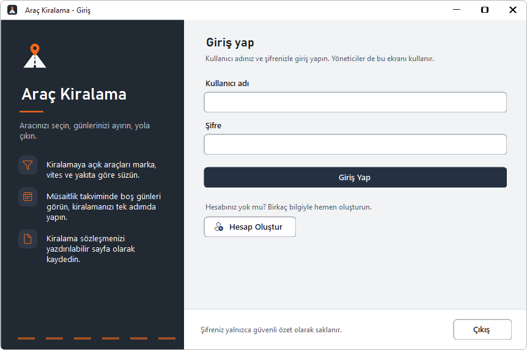](screenshots/giris-2x.png)<br>**Sign-in** ("Giriş") with the brand panel | [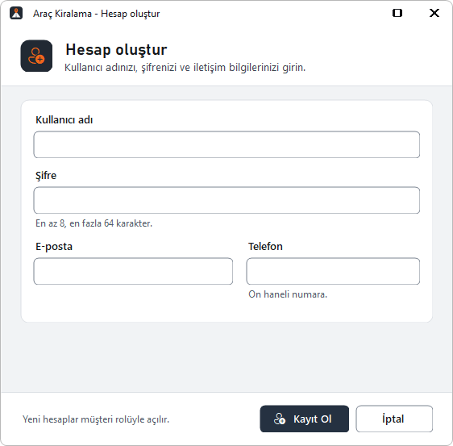](screenshots/hesap-olusturma-2x.png)<br>**Sign-up** ("Hesap oluştur") |
| [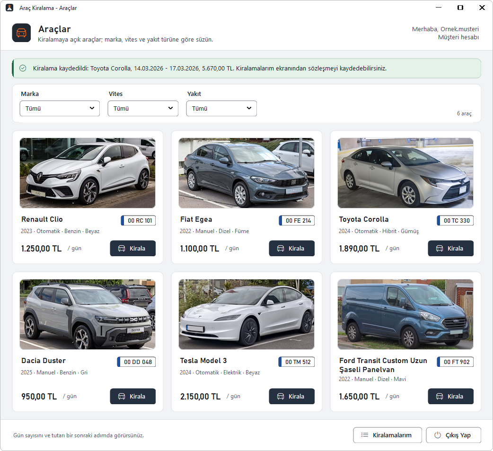](screenshots/araclar-2x.png)<br>**Cars** ("Araçlar") after a booking, reported inline | [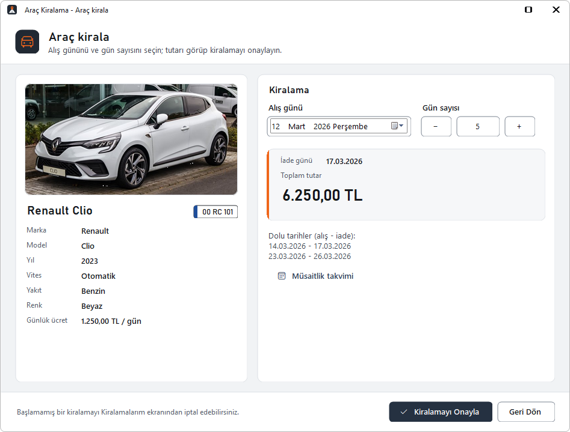](screenshots/arac-kiralama-2x.png)<br>**Book a car** ("Araç kirala") with the live total |
| [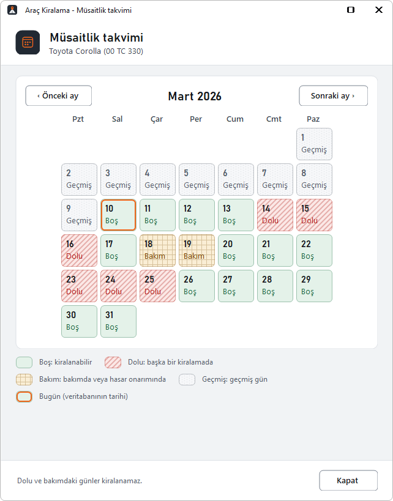](screenshots/musaitlik-takvimi-2x.png)<br>**Availability calendar** ("Müsaitlik takvimi") every day in words, pattern and tint | [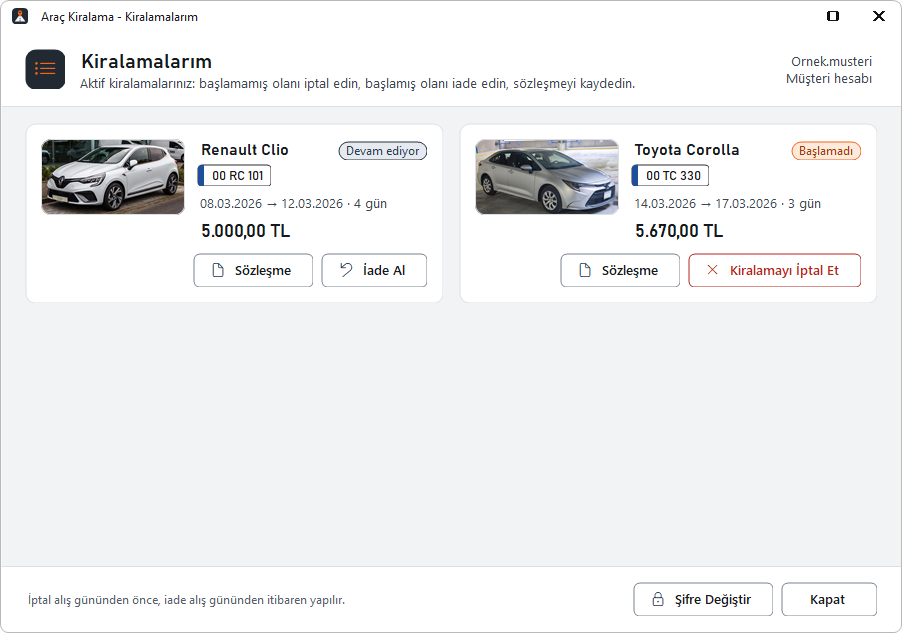](screenshots/kiralamalarim-2x.png)<br>**My rentals** ("Kiralamalarım") cancel, return, contract |
| [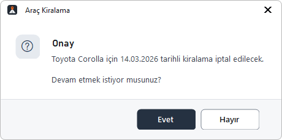](screenshots/onay-penceresi-2x.png)<br>**Confirmation** ("Onay") before a rental is cancelled | [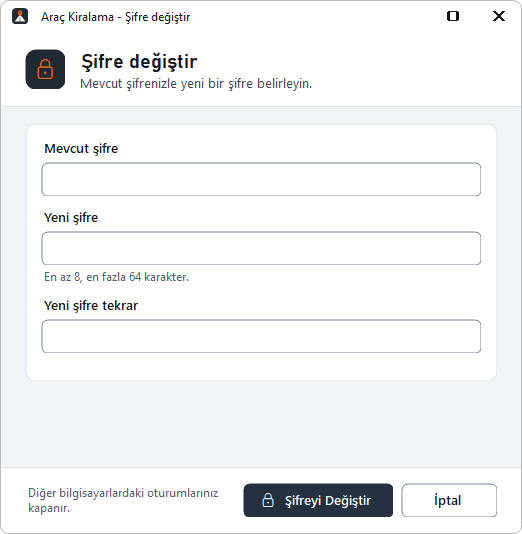](screenshots/sifre-degistirme-2x.png)<br>**Change password** ("Şifre değiştir") |
| [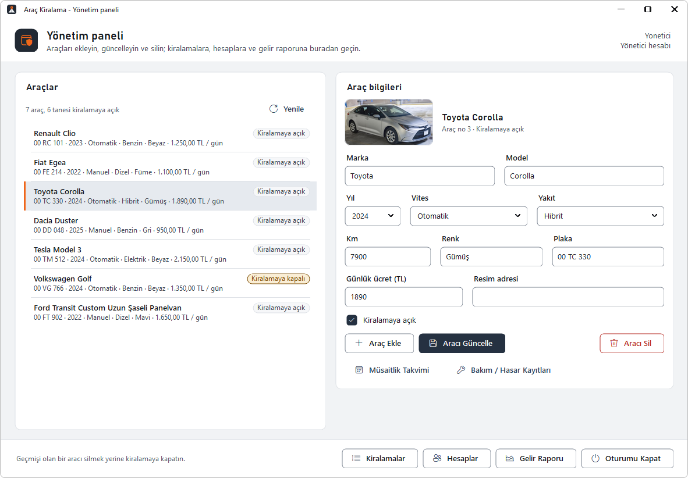](screenshots/yonetim-paneli-2x.png)<br>**Admin panel** ("Yönetim paneli") cars beside the edit form | [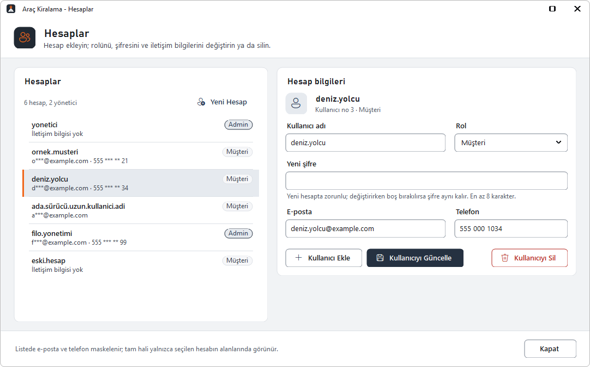](screenshots/hesaplar-2x.png)<br>**Accounts** ("Hesaplar") contact data masked in the list |
| [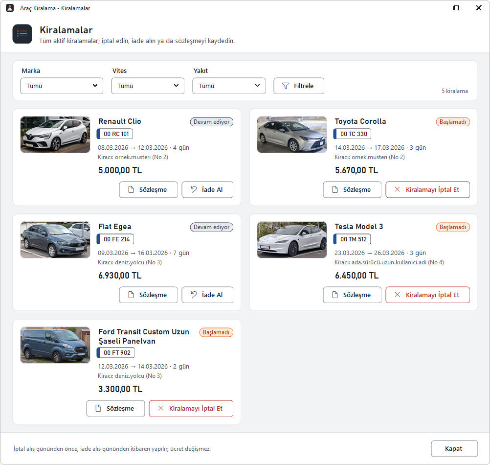](screenshots/kiralamalar-2x.png)<br>**Rentals** ("Kiralamalar") every active rental with its renter | [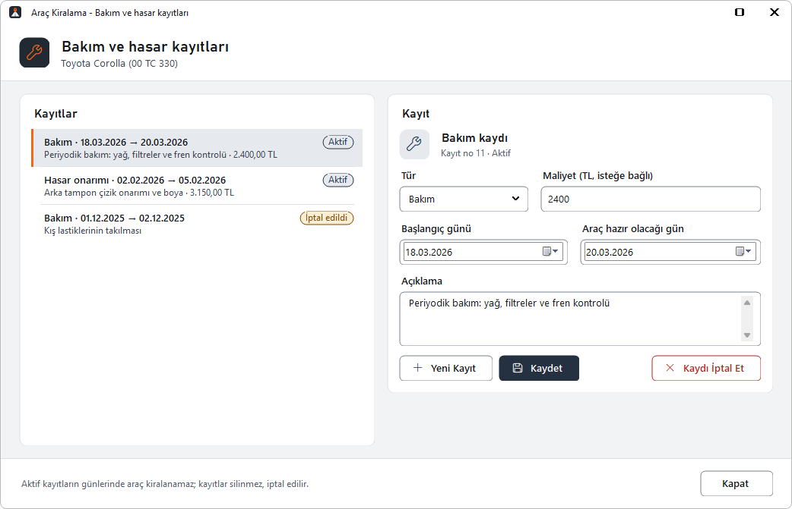](screenshots/bakim-kayitlari-2x.png)<br>**Maintenance and damage log** ("Bakım ve hasar kayıtları") |
| [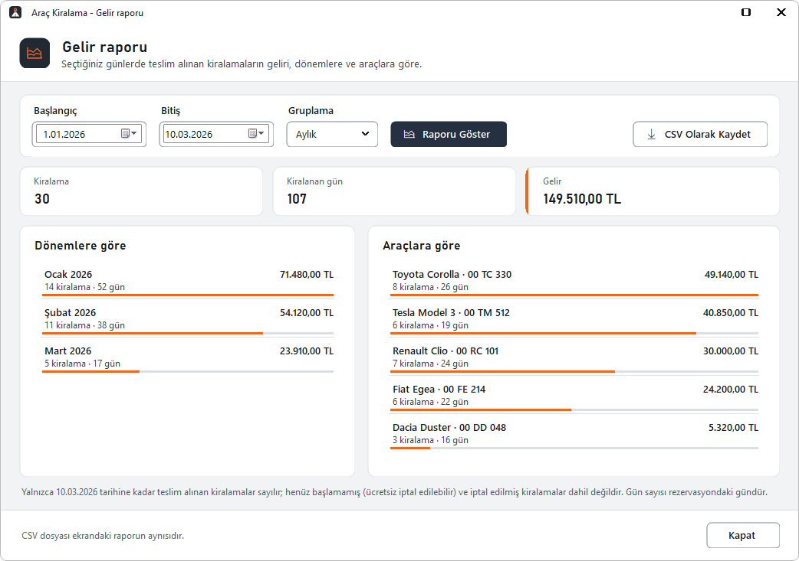](screenshots/gelir-raporu-2x.png)<br>**Revenue report** ("Gelir raporu") totals, periods and cars with bars | [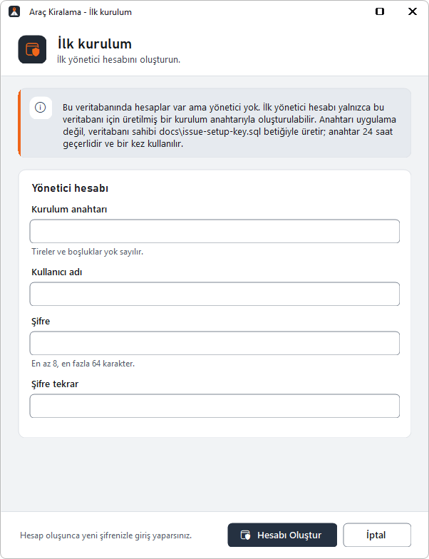](screenshots/ilk-kurulum-2x.png)<br>**First-run setup** ("İlk kurulum") with the setup key |

---

## 🔑 Permission Matrix

| Action | User | Admin |
|---|---|---|
| Sign up an account | ✅ (from the sign-in screen, user role) | ❌ (the first admin comes from the setup) |
| Sign in | ✅ | ✅ |
| Browse and filter the cars | ✅ listed cars | ✅ |
| Book a car | ✅ | ✅ (through the services; the admin screens do not offer it) |
| List active rentals | ✅ their own | ✅ all, with filters |
| Cancel or return a rental | ✅ their own | ✅ any |
| Change their own password | ✅ (profile) | ✅ (through the account management) |
| Add, change or delete cars | ❌ | ✅ |
| Add, change or delete accounts, set roles | ❌ | ✅ (no admin deleted, the last admin stays admin) |
| Create the first admin | ❌ (empty database, or with the owner's setup key only) | - |
| See a car's availability calendar | ✅ listed cars | ✅ any car |
| Log, change or cancel maintenance and damage records | ❌ | ✅ |
| Revenue report and its CSV | ❌ | ✅ |
| Save a rental contract | ✅ their own rentals | ✅ any rental |

---

## 🧰 Tech Stack

| Area | Used |
|---|---|
| Platform | .NET 10 (`net10.0-windows` UI, `net10.0` libraries) |
| UI | Windows Forms, own theming (light, dark, high contrast), per-monitor DPI |
| Data access | Entity Framework Core 10 (SQL Server provider) |
| Database | Microsoft SQL Server (Express is enough) |
| Password hashing | PBKDF2-HMAC-SHA256 (`Rfc2898DeriveBytes.Pbkdf2`) |
| Validation | FluentValidation |
| Configuration / DI | Microsoft.Extensions.Configuration (JSON, user secrets, environment), Microsoft.Extensions.DependencyInjection |
| Logging | Serilog (file sink, daily rolling) |
| Testing | xUnit v3, Moq, EF Core SQLite (in-memory), real SQL Server tests |
| CI | GitHub Actions (`.github/workflows/ci.yml`) |

---

## 🗂️ Project Structure

```text
AracKiralamaApp/
├── src/
│   ├── AracKiralama.Domain/     # Entities (User, Car, Rental, SetupKey) and repository contracts
│   ├── AracKiralama.Business/   # Auth, setup, car, rental and account services, prices, Security/ (PBKDF2, lockout, setup keys), Validation/ (FluentValidation), Auditing/
│   ├── AracKiralama.Data/       # EF Core DbContext, configurations, Persistence/Migrations/, legacy upgrade, car locks, database clock, demo data, repositories
│   └── AracKiralama.UI/         # WinForms screens, Theming/ (palettes, fonts, themed controls, vehicle art), Infrastructure/ (screen frame, errors, logging, dialogs, write guard, picture loader, bundled car photographs), Assets/Cars/ (car photographs), Program.cs (composition root)
├── tests/
│   ├── AracKiralama.Business.Tests/  # Validators, audit codes, hashing, lockout, booking rules, prices and ownership (Moq)
│   ├── AracKiralama.Data.Tests/      # Services on SQLite; booking races, setup keys, the restricted login and the legacy upgrade on SQL Server
│   └── AracKiralama.UI.Tests/        # Screens, layout, themes, configuration, errors, logs, pictures, focus and write guards (no windows shown)
├── tools/Screenshots/           # Icon and README screenshots, drawn offscreen with a sample fleet
├── screenshots/                 # README images at 1x and 2x
├── assets/                      # Original logo (logo.svg) with its icon and 256 px raster
├── docs/
│   ├── issue-setup-key.sql      # Setup key, run by the database owner
│   ├── grant-app-login.sql      # Rights of the application's own login
│   ├── CREDITS.md               # Authors and licenses of the car photographs
│   └── THREAT_MODEL.md          # Threat model
├── .github/workflows/ci.yml     # Build, test, SQL Server and release workflow
├── CHANGELOG.md
└── AracKiralama.sln
```

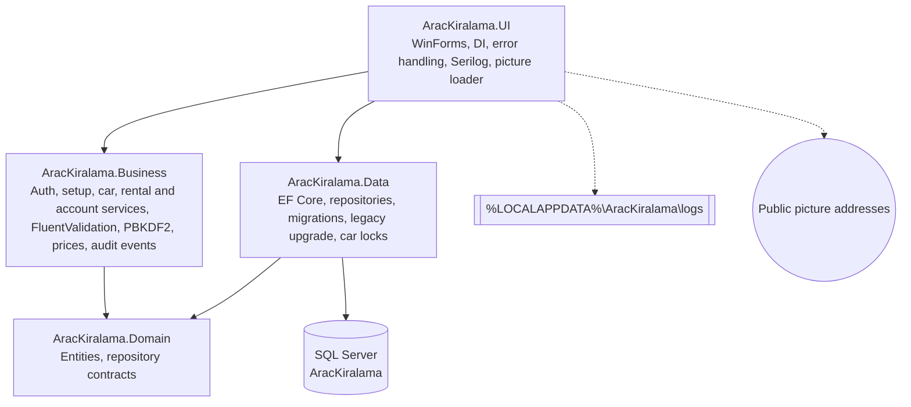

The UI references Data only to register dependencies at startup; forms work through the Business services, which
take the signed-in session on every call. All database access is asynchronous and parameterised. The provider is
configured through DI (`AddDataAccess`), so tests can use SQLite in-memory.

The forms, classes and code are named in English; the user interface and the database tables and columns of the
original application (`Kullanicilar`, `Araclar`, `Kiralama`) keep their Turkish names, so an existing database can be
upgraded in place.

---

## 🛠️ Setup and Usage

### Requirements

- .NET 10 SDK (Windows)
- SQL Server (Express is enough)

```powershell
git clone https://github.com/ayberkaarda/AracKiralamaApp.git
cd AracKiralamaApp
dotnet build -c Release
```

### 1. Configuration

The connection string is never written into the code. Provide one named `AracKiralama`; any of the following works
(later ones override earlier ones):

1. **`appsettings.json`**: copy `src/AracKiralama.UI/appsettings.example.json` to `appsettings.json` in the same
   folder and edit `ConnectionStrings:AracKiralama`. `appsettings.json` is git-ignored.

   ```json
   {
     "ConnectionStrings": {
       "AracKiralama": "Server=localhost\\SQLEXPRESS;Database=AracKiralama;Trusted_Connection=True;TrustServerCertificate=True;"
     },
     "Seed": {
       "Demo": false
     },
     "Appearance": {
       "Theme": "Light"
     },
     "Rental": {
       "MinRentalDays": 1,
       "MaxRentalDays": 90,
       "MaxAdvanceDays": 365,
       "LongRentalDays": 0,
       "LongRentalDiscountPercent": 0
     }
   }
   ```

2. **User secrets**:

   ```powershell
   dotnet user-secrets set "ConnectionStrings:AracKiralama" "Server=YOUR_SERVER_NAME;Database=AracKiralama;Trusted_Connection=True;TrustServerCertificate=True;" --project src/AracKiralama.UI
   ```

3. **Environment variable** `ConnectionStrings__AracKiralama`.
4. **Environment variable** `ARAC_CONNECTION` (highest priority):

   ```powershell
   $env:ARAC_CONNECTION = "Server=YOUR_SERVER_NAME;Database=AracKiralama;Trusted_Connection=True;TrustServerCertificate=True;"
   ```

> Replace `YOUR_SERVER_NAME` with your SQL Server instance, for example `localhost\SQLEXPRESS`. Inside JSON the `\`
> is written as `\\`. `TrustServerCertificate=True` is meant for a local development server only.

The `Rental` section takes whole numbers: `MinRentalDays` (1-3650), `MaxRentalDays` (from `MinRentalDays` to 3650),
`MaxAdvanceDays` (0-3650, 0 allows bookings starting today only), and `LongRentalDays` (0-3650) with
`LongRentalDiscountPercent` (0-90): rentals of at least `LongRentalDays` days get that discount; 0 turns it off. If no
connection string is found or the rental settings are invalid, the application shows a Turkish message naming the
problem and exits. `Appearance:Theme` is `Light` (default), `Dark` or `System`; any other value means `Light`, and
Windows high contrast always wins.

### 2. Running

```powershell
dotnet run --project src/AracKiralama.UI
```

You do not need to create tables by hand: the database is created on first start and pending EF Core migrations
are applied automatically on every start.

### 3. Database migrations and upgrading an old database

New migrations are applied by the application on start. To list them, apply them by hand or add one:

```powershell
dotnet tool restore
dotnet ef migrations list --project src/AracKiralama.Data
dotnet ef database update --project src/AracKiralama.Data
dotnet ef migrations add <Name> --project src/AracKiralama.Data --output-dir Persistence/Migrations
```

The design-time factory reads `ARAC_CONNECTION` and otherwise uses a local SQL Server Express instance. Apply
migrations with the database owner's connection; the application's restricted login has no DDL rights.

The migrations after the first one are `AddSessionVersion` (the accounts' session version, `OturumSurumu`),
`AddMaintenanceLog` (the `AracBakim` table of the maintenance and damage log) and `AddCarVersion` (the cars' version,
`Surum`, which refuses a change from a stale form). After applying them run `docs/grant-app-login.sql` again, so the
application's login can use the new table; new columns are covered by the existing table rights.

**Upgrading the original application's database:** `dotnet ef database update` does **not** upgrade it. Such a
database has the tables `Kullanicilar`, `Araclar` and `Kiralama` but no migrations history, so EF Core would try to
create the tables again. Start the application instead: on start-up `DatabaseInitializer` first runs the legacy
upgrade, which brings the old tables to the shape of the first migration and records it as applied, and only then
applies the remaining migrations. The upgrade keeps every row, identity value and plain text password: passwords
are marked as legacy plain text and hashed on each account's next successful sign-in, the original rentals become
active rentals with their pick-up and return days, a car hidden by hand stays unlisted, and the unused, empty
`Musteriler` table is dropped. It runs in one transaction under an application lock (`sp_getapplock`), so concurrent
starts upgrade once, and it is safe to repeat. When rows have no certain meaning (an unknown role or car status,
missing car data, a rental without its car, account or return day, rentals of one car that share days, customer
records in `Musteriler`), it stops before changing anything and the application lists the problems as counts only.

Accounts of the original application may have names, e-mail addresses or phone numbers that today's rules refuse.
They keep them: the admin's account form sends such a value back unchanged and it is stored as it was; only a
changed value has to follow the rules. The same holds for a gearbox or fuel type of an original car that is in
neither list.

Take a backup of the database before the first start with the new version and keep it protected: it still
contains the plain text passwords.

### 4. First-run setup

- **Empty database (no account at all):** the default installation creates no account and contains no ready-made
  password. The **"İlk Kurulum"** (First-Run Setup) screen opens and you create the first admin account with a
  password of your own choosing. No key is needed. Closing the setup ends the application.
- **Database with accounts but no admin** (for example an upgraded old database): the application opens with the
  normal sign-in; a missing admin alone gives nobody any rights. The first admin can be created only with a
  **setup key**: the **"İlk yönetici kurulumu"** (First admin setup) link on the sign-in screen opens the setup form,
  which asks for the key ("Kurulum Anahtarı", Setup Key).
- The application never creates keys. Only the **database owner** (db_owner or sysadmin) runs
  `docs/issue-setup-key.sql` connected to the application's database, for example
  `sqlcmd -S <server> -d <database> -E -i docs\issue-setup-key.sql`. The script makes a 32 hexadecimal character
  key from 16 random bytes (128 bits), stores only its SHA-256 hash in the `KurulumAnahtarlari` table and shows the
  key once. It refuses to issue a key when the database already has an admin.
- `docs/grant-app-login.sql` gives the application's own login example rights: on the key table only reading and
  marking a key used; it cannot add, delete or change a key. Rentals and maintenance records are never deleted. Do
  the first start (schema creation or upgrade) with the database owner's connection, then point the application's
  connection string at this login.
- Type the key into the form (dashes, spaces and letter case do not matter) or provide it with the
  `ARAC_SETUP_KEY` environment variable, which only fills in the field. A key is valid for 24 hours and works once:
  it is marked used together with the write that creates the admin account. Its expiry is decided by the
  database's clock, and every wrong attempt is followed by a 1 second pause.

### 5. Demo mode

Demo mode is opt-in and off by default. The environment variable `ARAC_DEMO=1` (or `true`), or
`"Seed": { "Demo": true }` in `appsettings.json`, adds five sample cars of common models (Renault Clio, Fiat Egea,
Ford Transit Custom, Fiat 500 and Tesla Model 3, with demonstration plates starting with `00`) only to a completely
empty database. Demo mode creates **no account**: the first admin is created through the first-run setup
as usual.

### 6. Logs

Logs are written to `%LOCALAPPDATA%\AracKiralama\logs`, one file per day (`arackiralama-yyyyMMdd.log`). Files older
than 30 days are deleted, and at most 30 files are kept. The folder is outside the repository. Error entries contain
only exception types, HResult codes and the method names of the stack trace (no messages, no file paths). Refused
operations leave no entry of their own. Audit entries are a fixed code and a role only, never an account, a car or
a date: every failed sign-in (empty field, unknown account, wrong password or locked account) writes the same code,
`auth.sign_in.failed unknown`; a new account and a sign-up with taken values both write
`auth.account.registration_submitted user`; ending another account's rental leaves the same entries as ending one
that does not exist.

User names, e-mail addresses, phone numbers, passwords, setup keys, cars, plates, amounts and exception messages are
never written to the log.

---

## 🔐 Security

See [docs/THREAT_MODEL.md](docs/THREAT_MODEL.md) for the threat model.

- Passwords are hashed with PBKDF2; the stored format is kept in its own column, so a value is never read in
  another format.
- Lockout counters are updated atomically, and a successful sign-in is written only while the account is still
  unlocked and unchanged, so concurrent attempts cannot clear a fresh lock.
- Bookings take an application lock per car (`sp_getapplock`) and check for shared days inside the same
  transaction; a filtered unique index backs it up. The database command timeout (90 seconds) is longer than any
  lock wait, so a busy car ends with "İşlem meşgul" (Operation busy) instead of a timeout.
- Roles and ownership are checked in the services and repeated in the database statements; the stored role of the
  acting account is checked inside every privileged write.
- Car picture addresses come from the database, so they are downloaded only from public addresses, without
  redirects or a proxy, at most 2 MB, 4096 pixels per side and within 10 seconds; local paths, network shares and
  local network addresses are never opened.
- Connection strings are kept out of the repository (`appsettings.json` is ignored; user secrets and environment
  variables are supported). All queries go through EF Core with parameters.
- Users only see Turkish messages; raw exception text is never shown.

---

## 🧪 Testing

```powershell
dotnet test -c Release
```

| Project | Type | Scope |
|---|---|---|
| `tests/AracKiralama.Business.Tests` | Unit | Validator limits and message order (user name 3/32, password 8/64, e-mail, phone, car fields, plates, rental days and dates), kept legacy values, audit codes, PBKDF2 and format upgrade, lockout, booking and price rules, ownership and admin checks with strict Moq mocks, session versions, maintenance input, calendar states, revenue sums and limits, formula-safe CSV, contract encoding and CSP |
| `tests/AracKiralama.Data.Tests` | Integration | Services and repositories on SQLite in-memory (overlap boundaries, shortest and longest rental, booking horizon, cancel or return by day, IDOR answers, lockout length, demoted sessions, refused input writes nothing); maintenance blocks and stale versions, calendar, revenue and contract owner checks, sessions ended by role or password changes; booking, lockout, maintenance and stale-save races, a busy car lock under a short command timeout, setup keys and every new feature under the restricted login and the legacy upgrade on SQL Server |
| `tests/AracKiralama.UI.Tests` | Unit | Every screen inside working areas of 1024x600, 1366x768 and 1920x1040 at text sizes 1 to 2 with long names (no clipping, no overlaps, header and footer in view), themed controls, tab order, inline messages, palette contrast, high contrast with the system colours and its switch while screens are open, card and calendar layout, vehicle art, bundled car photographs (credited, size-limited, matched by make and model, drawn in every palette), example configuration, error messages, log content and retention, picture address checks, focus after unlock, write guards, latest-wins loading of calendar months and reports, single maintenance and contract saves, stale-save reloads, font-sized calendar cells, neutral branding |

The SQL Server tests use throw-away databases on the server in `ARAC_TEST_SQLSERVER` (default: local SQL Express
with Windows authentication). They are skipped when `ARAC_SKIP_SQL_TESTS=1` is set or no server is reachable; with
`ARAC_REQUIRE_SQL_TESTS=1` (the SQL Server job of the CI) an unreachable server fails them instead. The temporary
databases are dropped afterwards. The test with a restored backup of the original database runs only when
`ARAC_LEGACY_BACKUP` points to a `.bak` file readable by the SQL Server service.

```powershell
$env:ARAC_SKIP_SQL_TESTS = "1"; dotnet test -c Release
```

On SQLite the schema is created from the model instead of migrations. The UI tests create forms without showing
them and replace every message box, so no window opens.

---

## 🚀 CI and Release

`.github/workflows/ci.yml` runs on pushes to `main`, on pull requests and on `v*` tags:

1. **build-test** (Windows): `dotnet build -c Release` and `dotnet test -c Release` (SQL Server tests skipped)
2. **sql-server** (Linux): the data tests against a throw-away SQL Server container, with
   `ARAC_REQUIRE_SQL_TESTS=1`
3. **release** (only on `v*` tags): the tag name is passed through an environment variable and checked against
   `^v[A-Za-z0-9._-]+$`; a framework-dependent win-x64 build is then published and uploaded as the workflow
   artifact `AracKiralama-<tag>-win-x64.zip`, together with the READMEs, the changelogs, the license, `docs/*.sql`
   and the image credits (`docs/CREDITS.md`)

To produce the same build locally:

```powershell
dotnet publish src/AracKiralama.UI -c Release -r win-x64 --self-contained false -o ./publish
```

The target machine needs the .NET 10 Desktop Runtime. Put `appsettings.json` next to `AracKiralama.exe` or set
`ARAC_CONNECTION`.

---

## 👨‍💻 Developer Notes

- See [CHANGELOG.md](CHANGELOG.md) for the version history.
- `Program.cs` is the composition root: configuration, DI, logging, the audit sink and the global
  `ThreadException` / `UnhandledException` handlers are set up there.
- Business rule violations raise `BusinessRuleException` and permission violations `AccessDeniedException`, both
  with fixed Turkish messages that the UI shows as warnings.
- Validators live in `AracKiralama.Business/Validation`. The account and rental validators stop at the first
  failure, so the user sees one message at a time; the car validator reports every invalid field.
- New write buttons should go through `ExclusiveOperation` and move the focus with `FocusAfterUnlock`; loads
  triggered by a selection should use `RequestSequence` so only the latest response is shown, and binding data in
  code must not count as a user's selection. Results and refusals of a screen go through `IUserPrompts` into its
  inline message strip; questions and messages outside a screen go through `Dialogs` (the themed message window),
  never `MessageBox` directly.
- New screens derive from `AppDialog` and are built with `FormLayout` and the themed controls in `Theming/`; colors
  come from the palette roles, never literals, and nothing sets a text color on selected or hovered items under high
  contrast. `tools/Screenshots` draws a new screen once it is added to `Screens.All`.
- Every privileged service call goes through `AccessGuard`, which reads the account's role from the database;
  repository writes take the acting account and check it again.
- Audit events carry only an event kind and a role; do not add identifying data to them.

---

## 📧 Contact

Feel free to get in touch with questions about the project, or send a pull request.

## Image credits

The car photographs come from Wikimedia Commons under CC0, CC BY or CC BY-SA licenses; [docs/CREDITS.md](docs/CREDITS.md)
lists the author, license, source page and changes of each one. They are not covered by the MIT License of the code:
each photograph keeps its own license.

This project is not affiliated with or endorsed by any vehicle manufacturer; car makes and model names are used for
identification only.

## License

The code is released under the [MIT License](LICENSE). The car photographs keep their own licenses (see
[Image credits](#image-credits)).
