# 🚗 Araç Kiralama - Araç Kiralama Sistemi (C# & SQL Server)

🇬🇧 [English](README.md) · 🇹🇷 **Türkçe**

.NET 10 ve SQL Server ile geliştirilmiş, bir araç kiralama şirketi için Windows Forms uygulaması: müşteriler hesap
oluşturur, araçlara göz atar, bir aracı belirli günler için kiralar ve kiralamayı iptal eder ya da aracı iade eder;
yöneticiler araçları, hesapları ve tüm aktif kiralamaları yönetir. Bir araç aynı gün için hiçbir zaman iki kez
kiralanamaz. Kod Domain, Business, Data ve UI katmanlarına ayrılmıştır; veritabanı erişimi EF Core ile yapılır ve
veritabanı açılışta otomatik olarak oluşturulur, migration'ları uygulanır ya da yükseltilir.

> Uygulamanın arayüzü Türkçedir. İngilizce README'de ekran ve düğme adları önce Türkçe etiketiyle, ardından
> İngilizce karşılığıyla verilir, örneğin "Araç Ekle" (Add Car).

---

## 📦 Özellikler

### Tasarım ve temalar

- ✅ **Kendi görsel kimliği**: asfalt grafit ve sinyal turuncusu, yol ve konum iğnesi logosu; başlıklar, ücretler,
  plakalar ve takvim günleri Bahnschrift (Windows'un DIN tarzı trafik levhası yazı tipi), metinler Segoe UI ile.
  Yaygın araç modelleri, Wikimedia Commons'tan alınıp uygulamayla birlikte gelen bir fotoğrafla gösterilir (bkz.
  [Görsel kaynakları](#görsel-kaynakları)); diğer araçlar kendi renginde kodla çizilir.
- ✅ **Açık, koyu ve yüksek karşıtlık**: `Appearance:Theme` ayarı `Light` (varsayılan), `Dark` ya da `System` (Windows
  uygulama modunu izler) seçer. Yüksek karşıtlık her zaman önceliklidir; Windows sistem renkleri ve yerel denetimler
  kullanılır, seçili ve üzerine gelinen öğeler HighlightText ile yazılır. Açık ekranlar, uygulama çalışırken yüksek
  karşıtlık ya da uygulama modu değişince kendini günceller.
- ✅ **Her ekran için tek çerçeve**: ekranın ne için olduğunu söyleyen başlık, sonuçlar ve retler için pencere içi
  ileti şeridi (odağı alan ileti penceresi yok; yalnızca sorular temalı bir pencerede sorulur), içerik ve işlemlerin
  bulunduğu alt bilgi. Pencereler içeriğe göre boyutlanır, ekranın çalışma alanından büyük açılmaz ve küçük ekranda
  gövdeleri kayar; uygulama monitör başına DPI uyumludur.

### Araç kataloğu

- ✅ **Katalog** ("Araçlar"): kiralamaya açık araçlar kartlar hâlinde; resim, marka, model, plaka, yıl, vites tipi,
  yakıt tipi, renk ve günlük ücretle.
- ✅ **Filtreler**: marka ("Marka"), vites tipi ("Vites Tipi") ve yakıt tipi ("Yakıt Tipi"); filtre listelerinin
  doldurulması kendiliğinden yükleme başlatmaz ve yalnızca son filtrenin cevabı gösterilir.
- ✅ **Araç resimleri**: on iki yaygın model (Renault Clio, Fiat Egea, Toyota Corolla, Volkswagen Golf, Dacia Duster,
  Peugeot 2008, Tesla Model 3, Fiat 500, Ford Transit Custom, Volkswagen Touran, Mazda MX-5, Fiat Doblò) uygulamayla
  birlikte gelen bir fotoğrafla gösterilir; eşleşme marka ve modele göre yapılır ("Renault" + "Clio 1.0 TCe" Clio ile
  eşleşir). Fotoğraf aracın kendisini değil modelini gösterir. Aracın kendi resim adresi arka planda ve yalnızca
  herkese açık http veya https adreslerinden yüklenir ve fotoğrafın yerine geçer; diğer her araç uygulamanın onu
  kendi renginde gösteren çizimiyle görünür. Birlikte gelen fotoğraflar için web'den hiçbir şey yüklenmez.

### Kiralama, iptal ve iade

- ✅ **Kiralama** ("Kirala" → "Araç kirala"): alış günü ("Alış günü") ve gün sayısı ("Gün sayısı") seçilir; ekran
  iade gününü ve toplam tutarı değiştikçe gösterir, aracın dolu olduğu günleri listeler. "Kiralamayı Onayla" alış ve
  iade tarihlerini ve toplam tutarı gösterip onay ister. Ödeme alınmaz.
- ✅ **Günler yarı açık aralıktır**: bir kiralama alış gününden iade gününe kadar olan günleri tutar, iade günü
  dahil değildir. Bir kiralama başka birinin bittiği gün başlayabilir; ortak bir gün, iki müşteri aynı anda kiralasa
  bile reddedilir.
- ✅ **Ayarlar** (`Rental` bölümü): en kısa ve en uzun kiralama (varsayılan 1 ve 90 gün), kiralamanın en fazla kaç
  gün sonra başlayabileceği (varsayılan 365 gün) ve isteğe bağlı uzun kiralama indirimi (varsayılan kapalı).
  Kiralama hiçbir zaman geçmiş bir günde başlamaz.
- ✅ **Ücret kontrolü**: teklif gösterildikten sonra günlük ücret değişirse kiralama reddedilir ve hiçbir şey
  yazılmaz.
- ✅ **İptal veya iade**: "Kiralamalarım" ekranında hesabın kendi aktif kiralamaları aşamalarıyla ("Başlamadı",
  "Devam ediyor") kartlar hâlinde listelenir; alış gününden önce "Kiralamayı İptal Et" tüm günleri boşaltır, kiralama başladıktan sonra "İade Al"
  aracı bugün teslim alır ve kalan günleri boşaltır. Yöneticiler kiralama panelinde aynısını her kiralama için
  yapar. Kiralamalar hiçbir zaman silinmez; satırları yeni bir durumla kalır.

### Yönetim paneli

- ✅ **Araçlar** ("Yönetim paneli"): marka, model, yıl, vites tipi, yakıt tipi, kilometre, renk, plaka, günlük ücret
  ve resim adresiyle ("Resim adresi") araç ekleme ("Araç Ekle"), güncelleme ("Aracı Güncelle") ve silme ("Aracı Sil").
  Her geçersiz alan kırmızı bir çerçeve ve kendi iletisiyle işaretlenir. Plakalar benzersizdir. Kiralama geçmişi olan araç
  silinemez; bunun yerine "Kiralamaya açık" seçeneği aracı müşterilerden gizler. Başka bir yöneticinin
  değişikliğinden (yeni ücret, kiralamaya kapatma) önce açılmış bir formdan yapılan değişiklik reddedilir ve araç
  yeniden yüklenir.
- ✅ **Hesaplar** ("Hesaplar"): rol, e-posta ve telefonla (listede maskeli) hesap ekleme,
  güncelleme ve silme; yeni şifre eskisinin yerine geçer ve kilidi kaldırır. Yöneticiler ve kiralaması olan hesaplar
  silinemez, son yönetici yönetici rolünü korur. Hesap başka bir yerde düzenlenmeden önce açılmış bir formdan yapılan
  değişiklik reddedilir ve hesap yeniden yüklenir; böylece eski bir form, başka bir yöneticinin az önce aldığı rolü
  geri veremez ve az önce düzelttiği e-posta adresini eski hâline döndüremez. Kendi rolünü veya şifresini değiştiren
  yöneticinin oturumu kapatılır.
- ✅ **Kiralamalar** ("Kiralamalar"): tüm aktif kiralamalar kiracılarıyla; marka, vites tipi ve yakıt tipine göre
  filtrelenebilir.

### Takvim, bakım, raporlar ve sözleşmeler

- ✅ **Müsaitlik takvimi** ("Müsaitlik Takvimi"): bir aracın bir ayı; her gün veritabanının bugününe göre "Boş",
  "Dolu", "Bakım" (bakım veya hasar onarımı) ya da "Geçmiş" olarak işaretlenir; ilk gösterilen ay da bu bugüne göre
  seçilir. Müşteriler kiralamaya açık araçlar için kiralama ekranından açar ve bugünden önceki her günü "Geçmiş"
  görür; yöneticiler her araç için yönetim panelinden açar ve kiralama ile bakımın geçmiş günlerini de görür. Durum
  her hücrede yazılıdır; renkler yalnızca yardımcıdır, yüksek karşıtlıkta sistem renkleri korunur. Ay düğmelerine hızlı
  tıklamalar toplanır; en son istenen ay gösterilir.
- ✅ **Bakım ve hasar kayıtları** ("Bakım / Hasar Kayıtları", yönetici): planlı bakım veya hasar onarımı; günleri,
  açıklaması ve isteğe bağlı maliyetiyle. Araç bu günlerde kiralanamaz ve bir kayıt aktif bir kiralamanın veya aracın
  başka bir aktif kaydının günlerini alamaz. Yanlış girilen kayıt silinmez, iptal edilir. Başka bir yöneticinin
  değişikliğinden önce açılmış bir formun kaydı reddedilir ve kayıt yeniden yüklenir; başka her retten sonra
  yöneticinin yazdıkları formda kalır. Zamanlar yazma anında veritabanının saatiyle damgalanır ve gün sınırları da o
  anda bu saatle denetlenir.
- ✅ **Gelir raporu** ("Gelir Raporu", yönetici): iki gün arasındaki kiralamalar aylara veya günlere ve araçlara
  göre; bugüne kadar teslim alınmış her kiralama (iade edilmiş veya sürmekte olan), rezervasyonda belirlenen ücretiyle
  alış gününün dönemine yazılır; ekran bu aydan veritabanının bugününe kadarki aralıkla açılır. Henüz başlamamış
  kiralamalar hâlâ ücretsiz iptal edilebildiği için sayılmaz, böylece geçmiş bir rapor sonradan değişmez; iptal edilen
  kiralamalar gelir getirmez. Aralığın yalnızca bir kısmını kapsayan ay kendi günleriyle adlandırılır ve gün sayısı
  rezervasyondaki gündür. Ekran ve CSV bunu bir notla belirtir. "CSV Olarak Kaydet" ekrandaki raporu ";" ayraçlı
  UTF-8 CSV olarak kaydeder; her alan tırnak içindedir ve `=`, `+`, `-`, `@` ya da bir kontrol karakteriyle başlayan
  değer formül olarak değil metin olarak yazılır.
- ✅ **Kiralama sözleşmesi** (her kiralama kartında "Sözleşme"): kiralamayı, aracı ve kiracının e-posta adresini ve
  telefonunu gösteren yazdırılabilir bir HTML sayfası. Her değer HTML olarak kodlanır; sayfa betik çalıştırmaz, hiçbir
  şey yüklemez ve Content-Security-Policy ile yalnızca kendi stil bloğuna izin verir; kullanıcı adı, hesap numarası,
  şifre veya oturum bilgisi içermez. Müşteriler yalnızca kendi sözleşmelerini, yöneticiler hepsini alır.

### Güvenlik

- ✅ Şifreler PBKDF2-HMAC-SHA256 özetleri (600.000 tekrar, rastgele tuz) olarak saklanır; eski uygulamanın düz metin
  şifreleri bir sonraki başarılı girişte özetle değiştirilir.
- ✅ 5 hatalı giriş hesabı 15 dakika kilitler; bilinmeyen hesap, yanlış şifre ve kilitli hesap aynı cevabı alır.
  Hatalı giriş yalnızca hesap yazma anında kilitsiz ve değişmemişse sayılır; aynı anda gelen hatalı girişler hesabı
  bir kez kilitler, yöneticinin şifre sıfırlamasının arkasında kalan hatalı girişler sayılmaz.
- ✅ Kilitler, kiralama günleri, iptal mi iade mi kararı, bakım günlerinin sınırları ve en yeni model yılı veritabanının
  saatiyle belirlenir; aracın takvimine bağlı kararlar bu saati aracın kilidini aldıktan sonra okur, böylece gece
  yarısını kilit beklerken geçen bir istek yeni günle karar verir. Kiralama ekranı da sınırlarını bu saatten alır.
- ✅ Her çağrı oturum açmış hesaba göre denetlenir ve her yetkili işlem hesabın rolünü veritabanından yeniden okur:
  silinen ya da yetkisi alınan bir yöneticinin açık oturumu yetkilerini hemen kaybeder. Müşteriler yalnızca kendi
  kiralamalarına ulaşır; başka bir hesabın kiralaması, var olmayan bir kiralamayla aynı cevabı alır.
- ✅ Her hesabın bir oturum sürümü vardır; her rol değişikliği, yöneticinin belirlediği her şifre ve hesabın kendi
  şifre değişikliği bu sürümü artırır. Ayrıca hesabın her düzenlenişinde artan ve yöneticinin formunun geri gönderdiği
  bir düzenleme sürümü vardır. Değişiklikten önceki oturum, değişiklik geri alınsa bile kalıcı olarak
  reddedilir (yetkisi alınıp yeniden verilen yönetici yeniden giriş yapar). Kendi şifre değişikliği dahil her yazma
  işlemi sürümü, rolü ve hesabı kendi komutu veya transaction'ı içinde denetler. "Şifre Değiştir", hesabın diğer
  oturumlarını (örneğin çalınan şifreyle başka bir yerde açılmış olanı) kapatır; şifreyi değiştiren pencere çalışmaya
  devam eder.
- ✅ Bir aracın kiralama, iptal, iade, araç değişikliği ve bakım yazmaları aracın kilidini bekler (en fazla 30 saniye,
  her zaman komut zaman aşımından kısa) ve kilidi, işlemi yapan hesabı denetlemeden önce, hepsi aynı sırayla alır;
  meşgul bir kilit de, SQL Server'ın kilitlenme (deadlock) kurbanı seçtiği bir transaction da hiçbir şey yazmadan
  "İşlem meşgul ... tekrar deneyin" ile biter.
- ✅ Türkçe mesajlı merkezi FluentValidation doğrulayıcıları (boş alanlar, e-posta biçimi, şifre kuralı, araç
  alanları, kiralama günleri ve tarihleri); yazma düğmeleri bir işlem sürerken tekrarlanan tıklamaları yok sayar.
- ✅ Kişisel veri içermeyen, anonim denetim kodlu günlük log dosyaları.

---

## 🖼️ Ekran Görüntüleri

Ekranlar örnek bir filoyla (birlikte gelen fotoğraflarıyla yaygın gerçek modeller, hiçbir plakanın kullanmadığı
00 il koduyla gösterim plakaları, example.com üzerinde örnek hesaplar) pencere açılmadan çizilir; gerçek müşteri ya
da şirket verisi göstermez. Her görsel 2x sürümüne bağlanır. Yeniden çizmek için:
`dotnet run --project tools/Screenshots -c Release -- screenshots`.

| | |
|---|---|
| [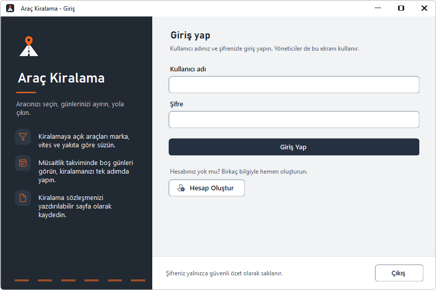](screenshots/giris-2x.png)<br>**Giriş**: marka paneliyle | [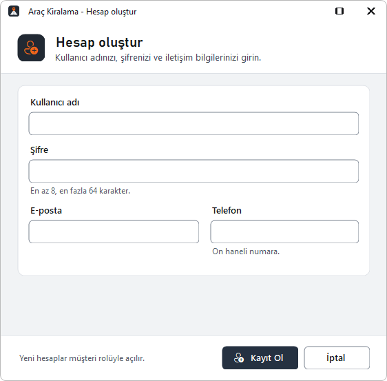](screenshots/hesap-olusturma-2x.png)<br>**Hesap oluştur** |
| [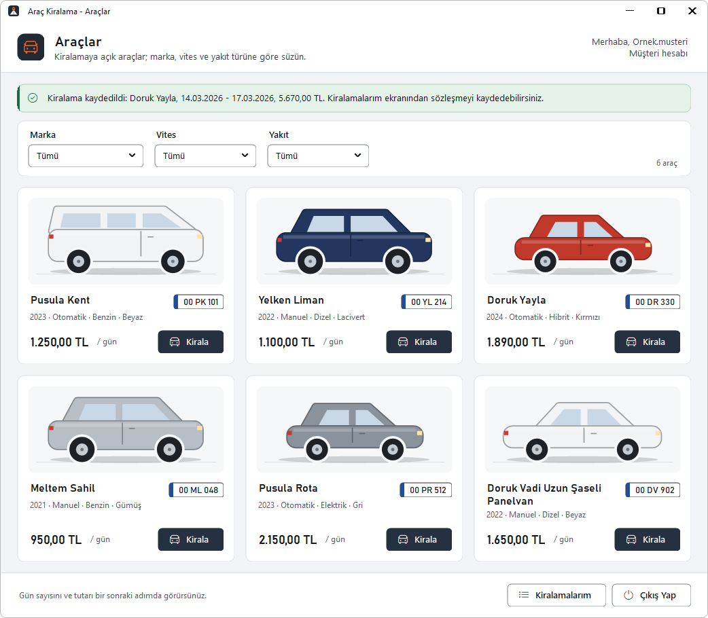](screenshots/araclar-2x.png)<br>**Araçlar**: kiralamadan sonra, sonuç pencerenin içinde | [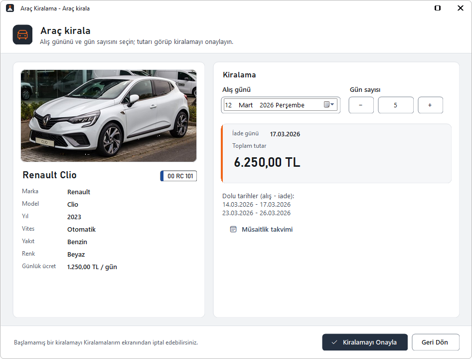](screenshots/arac-kiralama-2x.png)<br>**Araç kirala**: anlık toplam tutarla |
| [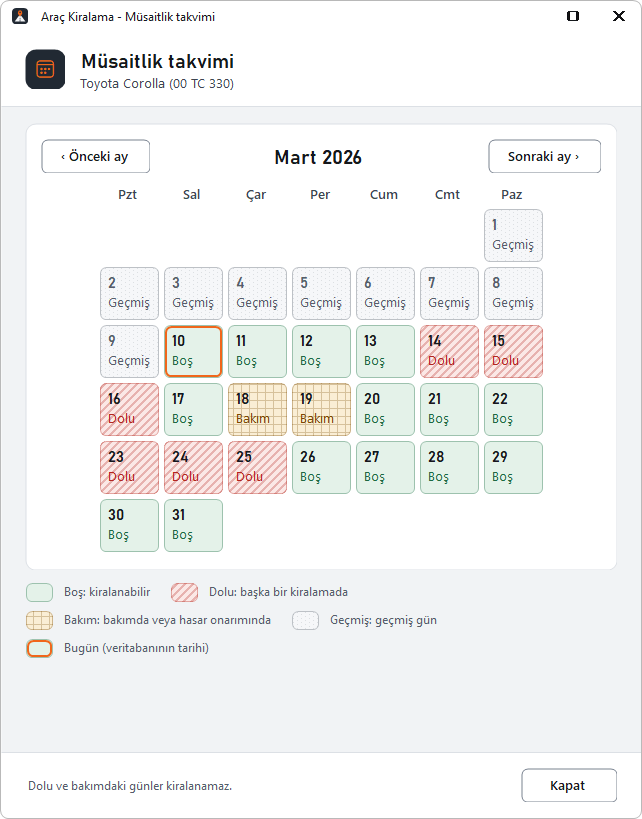](screenshots/musaitlik-takvimi-2x.png)<br>**Müsaitlik takvimi**: her gün yazı, desen ve renk tonuyla | [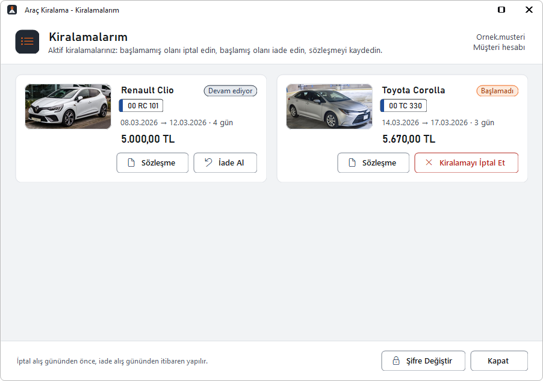](screenshots/kiralamalarim-2x.png)<br>**Kiralamalarım**: iptal, iade, sözleşme |
| [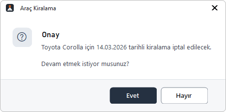](screenshots/onay-penceresi-2x.png)<br>**Onay**: kiralama iptal edilmeden önce | [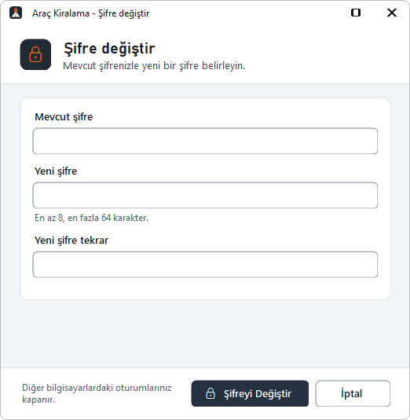](screenshots/sifre-degistirme-2x.png)<br>**Şifre değiştir** |
| [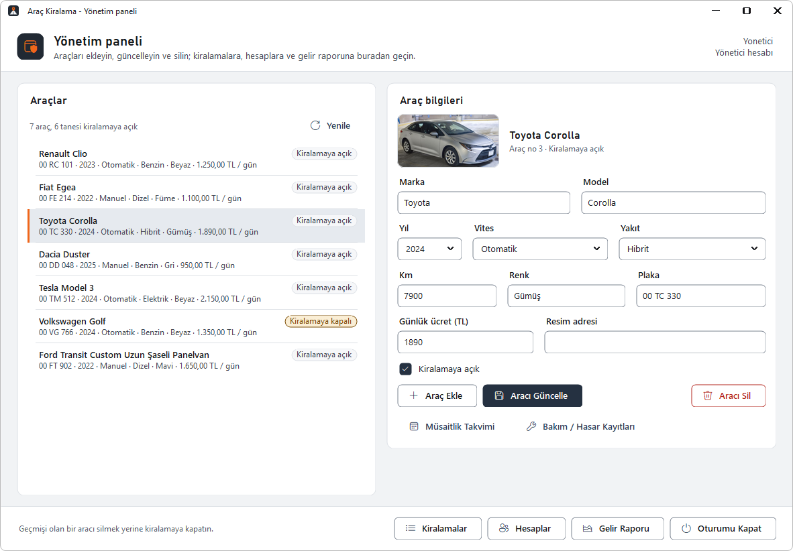](screenshots/yonetim-paneli-2x.png)<br>**Yönetim paneli**: araçlar ve düzenleme formu | [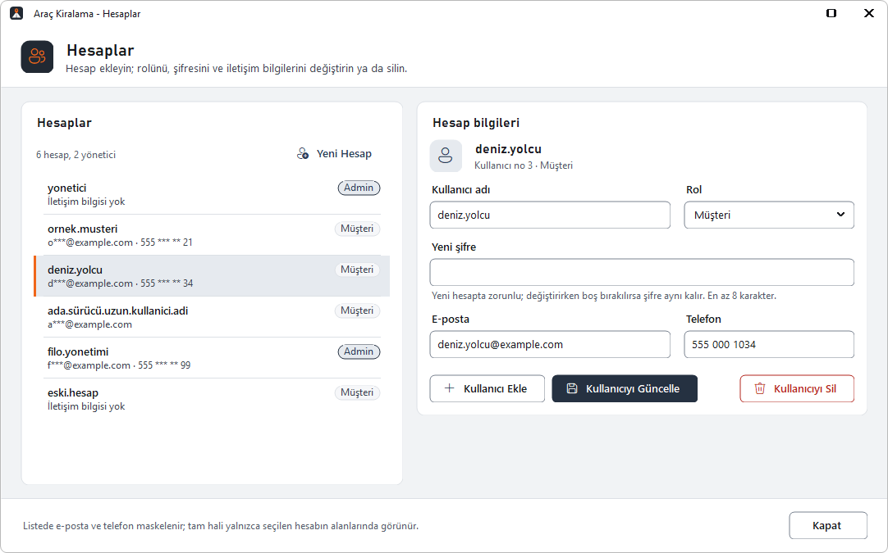](screenshots/hesaplar-2x.png)<br>**Hesaplar**: iletişim bilgileri listede maskeli |
| [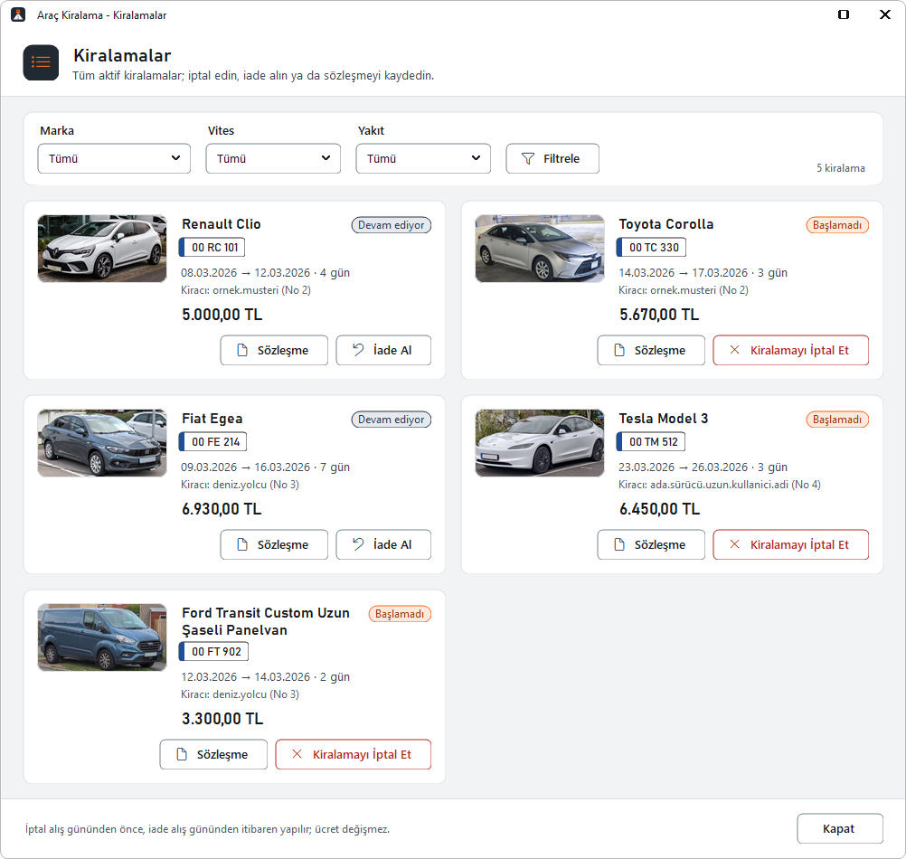](screenshots/kiralamalar-2x.png)<br>**Kiralamalar**: tüm aktif kiralamalar, kiracılarıyla | [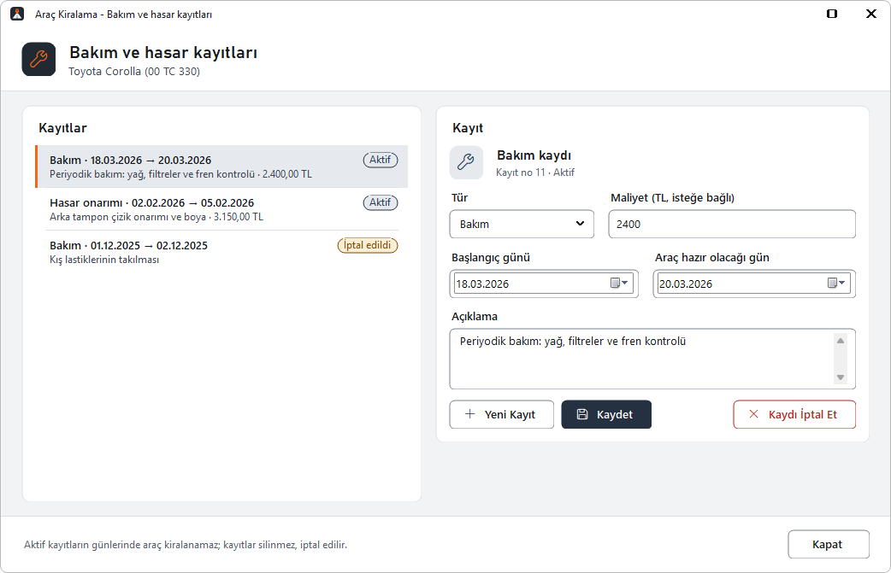](screenshots/bakim-kayitlari-2x.png)<br>**Bakım ve hasar kayıtları** |
| [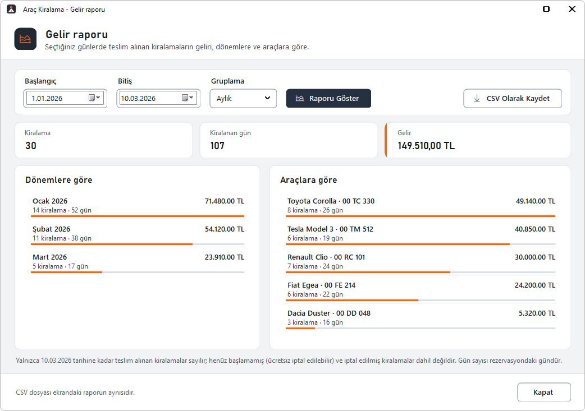](screenshots/gelir-raporu-2x.png)<br>**Gelir raporu**: toplamlar; dönemler ve araçlar çubuklarla | [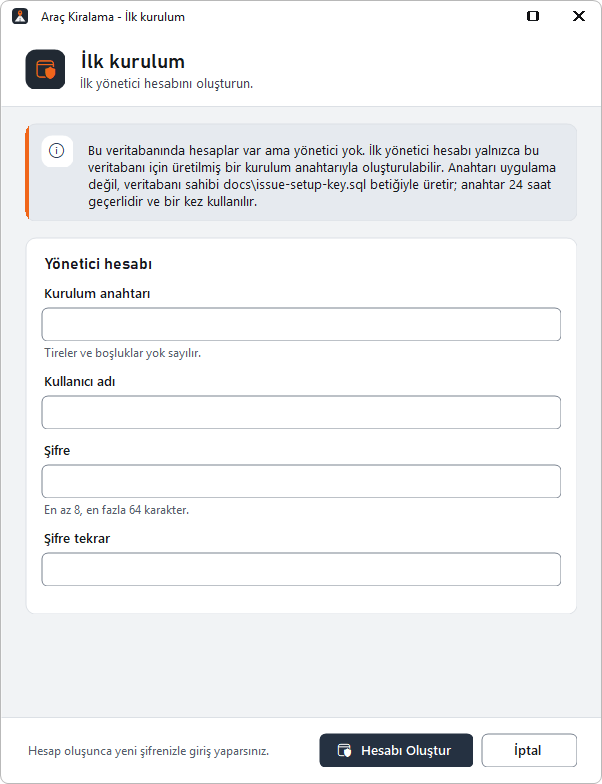](screenshots/ilk-kurulum-2x.png)<br>**İlk kurulum**: kurulum anahtarıyla |

---

## 🔑 Yetki Matrisi

| İşlem | Kullanıcı | Yönetici |
|---|---|---|
| Hesap oluşturma | ✅ (giriş ekranından, kullanıcı rolüyle) | ❌ (ilk yönetici kurulumdan gelir) |
| Giriş | ✅ | ✅ |
| Araçlara göz atma ve filtreleme | ✅ kiralamaya açık araçlar | ✅ |
| Araç kiralama | ✅ | ✅ (servisler üzerinden; yönetim ekranları sunmaz) |
| Aktif kiralamaları listeleme | ✅ kendi kiralamaları | ✅ hepsi, filtrelerle |
| Kiralamayı iptal etme veya iade alma | ✅ kendi kiralamaları | ✅ hepsi |
| Kendi şifresini değiştirme | ✅ (profil) | ✅ (hesap yönetimi üzerinden) |
| Araç ekleme, güncelleme, silme | ❌ | ✅ |
| Hesap ekleme, güncelleme, silme, rol atama | ❌ | ✅ (yönetici silinmez, son yönetici yönetici kalır) |
| İlk yöneticiyi oluşturma | ❌ (boş veritabanında veya yalnızca sahibin kurulum anahtarıyla) | - |
| Aracın müsaitlik takvimini görme | ✅ kiralamaya açık araçlar | ✅ her araç |
| Bakım ve hasar kaydı ekleme, değiştirme, iptal etme | ❌ | ✅ |
| Gelir raporu ve CSV dosyası | ❌ | ✅ |
| Kiralama sözleşmesini kaydetme | ✅ kendi kiralamaları | ✅ her kiralama |

---

## 🧰 Teknolojiler

| Alan | Kullanılan |
|---|---|
| Platform | .NET 10 (`net10.0-windows` arayüz, `net10.0` kütüphaneler) |
| Arayüz | Windows Forms, kendi teması (açık, koyu, yüksek karşıtlık), monitör başına DPI |
| Veri erişimi | Entity Framework Core 10 (SQL Server sağlayıcısı) |
| Veritabanı | Microsoft SQL Server (Express yeterli) |
| Şifre özeti | PBKDF2-HMAC-SHA256 (`Rfc2898DeriveBytes.Pbkdf2`) |
| Doğrulama | FluentValidation |
| Yapılandırma / DI | Microsoft.Extensions.Configuration (JSON, user secrets, ortam değişkenleri), Microsoft.Extensions.DependencyInjection |
| Loglama | Serilog (dosya, günlük dönen) |
| Test | xUnit v3, Moq, EF Core SQLite (bellek içi), gerçek SQL Server testleri |
| CI | GitHub Actions (`.github/workflows/ci.yml`) |

---

## 🗂️ Proje Yapısı

```text
AracKiralamaApp/
├── src/
│   ├── AracKiralama.Domain/     # Varlıklar (User, Car, Rental, SetupKey) ve repository sözleşmeleri
│   ├── AracKiralama.Business/   # Giriş, kurulum, araç, kiralama ve hesap servisleri, fiyatlar, Security/ (PBKDF2, kilit, kurulum anahtarı), Validation/ (FluentValidation), Auditing/
│   ├── AracKiralama.Data/       # EF Core DbContext, yapılandırmalar, Persistence/Migrations/, eski veritabanı yükseltmesi, araç kilitleri, veritabanı saati, demo verisi, repository'ler
│   └── AracKiralama.UI/         # WinForms ekranları, Theming/ (paletler, yazı tipleri, temalı denetimler, araç çizimi), Infrastructure/ (ekran çerçevesi, hatalar, loglama, iletişim kutuları, yazma koruması, resim yükleyici, birlikte gelen araç fotoğrafları), Assets/Cars/ (araç fotoğrafları), Program.cs (bileşim kökü)
├── tests/
│   ├── AracKiralama.Business.Tests/  # Doğrulayıcılar, denetim kodları, şifre özeti, kilit, kiralama kuralları, fiyatlar ve sahiplik (Moq)
│   ├── AracKiralama.Data.Tests/      # SQLite üzerinde servisler; SQL Server üzerinde kiralama yarışları, kurulum anahtarları, kısıtlı oturum ve eski veritabanı yükseltmesi
│   └── AracKiralama.UI.Tests/        # Ekranlar, yerleşim, temalar, yapılandırma, hatalar, loglar, resimler, odak ve yazma korumaları (pencere açılmaz)
├── tools/Screenshots/           # Simge ve README ekran görüntüleri, örnek bir filoyla pencere açılmadan çizilir
├── screenshots/                 # 1x ve 2x README görselleri
├── assets/                      # Özgün logo (logo.svg), simgesi ve 256 piksellik görseli
├── docs/
│   ├── issue-setup-key.sql      # Kurulum anahtarı, veritabanı sahibi çalıştırır
│   ├── grant-app-login.sql      # Uygulamanın kendi oturumunun yetkileri
│   ├── CREDITS.md               # Araç fotoğraflarının yazarları ve lisansları (İngilizce)
│   └── THREAT_MODEL.md          # Tehdit modeli (İngilizce)
├── .github/workflows/ci.yml     # Derleme, test, SQL Server ve sürüm iş akışı
├── CHANGELOG.tr.md
└── AracKiralama.sln
```

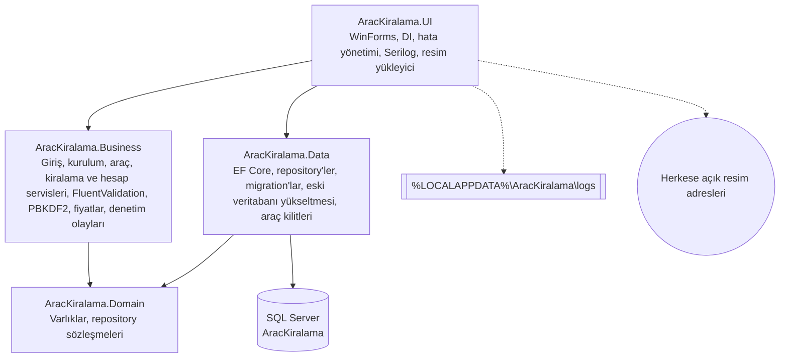

Arayüz Data katmanına yalnızca açılışta bağımlılıkları kaydetmek için başvurur; formlar her çağrıda oturum açmış
hesabı alan Business servisleri üzerinden çalışır. Tüm veritabanı erişimi asenkron ve parametrelidir. Sağlayıcı DI
üzerinden (`AddDataAccess`) yapılandırılır, böylece testler bellek içi SQLite kullanabilir.

Formlar, sınıflar ve kod İngilizce adlandırılmıştır; kullanıcı arayüzü ile eski uygulamanın veritabanı tabloları ve
sütunları (`Kullanicilar`, `Araclar`, `Kiralama`) Türkçe adlarını korur, böylece mevcut bir veritabanı yerinde
yükseltilebilir.

---

## 🛠️ Kurulum ve Kullanım

### Gereksinimler

- .NET 10 SDK (Windows)
- SQL Server (Express yeterli)

```powershell
git clone https://github.com/ayberkaarda/AracKiralamaApp.git
cd AracKiralamaApp
dotnet build -c Release
```

### 1. Yapılandırma

Bağlantı dizesi hiçbir zaman koda yazılmaz. `AracKiralama` adında bir bağlantı dizesi verin; aşağıdakilerden herhangi
biri olur (sonrakiler öncekileri geçersiz kılar):

1. **`appsettings.json`**: `src/AracKiralama.UI/appsettings.example.json` dosyasını aynı klasöre `appsettings.json`
   olarak kopyalayın ve `ConnectionStrings:AracKiralama` değerini düzenleyin. `appsettings.json` git tarafından yok
   sayılır.

   ```json
   {
     "ConnectionStrings": {
       "AracKiralama": "Server=localhost\\SQLEXPRESS;Database=AracKiralama;Trusted_Connection=True;TrustServerCertificate=True;"
     },
     "Seed": {
       "Demo": false
     },
     "Appearance": {
       "Theme": "Light"
     },
     "Rental": {
       "MinRentalDays": 1,
       "MaxRentalDays": 90,
       "MaxAdvanceDays": 365,
       "LongRentalDays": 0,
       "LongRentalDiscountPercent": 0
     }
   }
   ```

2. **User secrets**:

   ```powershell
   dotnet user-secrets set "ConnectionStrings:AracKiralama" "Server=YOUR_SERVER_NAME;Database=AracKiralama;Trusted_Connection=True;TrustServerCertificate=True;" --project src/AracKiralama.UI
   ```

3. **Ortam değişkeni** `ConnectionStrings__AracKiralama`.
4. **Ortam değişkeni** `ARAC_CONNECTION` (en yüksek öncelik):

   ```powershell
   $env:ARAC_CONNECTION = "Server=YOUR_SERVER_NAME;Database=AracKiralama;Trusted_Connection=True;TrustServerCertificate=True;"
   ```

> `YOUR_SERVER_NAME` yerine kendi SQL Server örneğinizi yazın, örneğin `localhost\SQLEXPRESS`. JSON içinde `\`
> karakteri `\\` olarak yazılır. `TrustServerCertificate=True` yalnızca yerel geliştirme sunucusu içindir.

`Rental` bölümü tam sayılar alır: `MinRentalDays` (1-3650), `MaxRentalDays` (`MinRentalDays` ile 3650 arası),
`MaxAdvanceDays` (0-3650; 0 yalnızca bugün başlayan kiralamalara izin verir) ve `LongRentalDays` (0-3650) ile
`LongRentalDiscountPercent` (0-90): en az `LongRentalDays` günlük kiralamalar bu indirimi alır; 0 indirimi kapatır.
Bağlantı dizesi bulunamazsa veya kiralama ayarları geçersizse uygulama sorunu belirten Türkçe bir mesaj gösterip
kapanır. `Appearance:Theme` ayarı `Light` (varsayılan), `Dark` ya da `System` olabilir; başka bir değer `Light`
sayılır ve Windows yüksek karşıtlığı her zaman önceliklidir.

### 2. Çalıştırma

```powershell
dotnet run --project src/AracKiralama.UI
```

Tabloları elle oluşturmanız gerekmez: veritabanı ilk açılışta oluşturulur ve bekleyen EF Core migration'ları her
açılışta otomatik olarak uygulanır.

### 3. Veritabanı migration'ları ve eski veritabanının yükseltilmesi

Yeni migration'ları uygulama açılışta uygular. Listelemek, elle uygulamak veya yeni bir tane eklemek için:

```powershell
dotnet tool restore
dotnet ef migrations list --project src/AracKiralama.Data
dotnet ef database update --project src/AracKiralama.Data
dotnet ef migrations add <Ad> --project src/AracKiralama.Data --output-dir Persistence/Migrations
```

Tasarım zamanı fabrikası `ARAC_CONNECTION` değişkenini okur, yoksa yerel SQL Server Express örneğini kullanır.
Migration'ları veritabanı sahibinin bağlantısıyla uygulayın; uygulamanın kısıtlı oturumunun DDL yetkisi yoktur.

İlk migration'dan sonrakiler `AddSessionVersion` (hesapların oturum sürümü, `OturumSurumu`), `AddMaintenanceLog`
(bakım ve hasar kayıtlarının `AracBakim` tablosu), `AddCarVersion` (araçların sürümü, `Surum`; eski bir formdan gelen
değişikliği reddeder) ve `AddAccountEditVersion`'dır (hesapların düzenleme sürümü, `DuzenlemeSurumu`; eski bir formdan
gelen hesap değişikliğini reddeder). Bunları uyguladıktan sonra uygulamanın oturumunun yeni tabloyu kullanabilmesi için
`docs/grant-app-login.sql` betiğini yeniden çalıştırın; yeni sütunlar mevcut tablo yetkileriyle kapsanır.

**Eski uygulamanın veritabanını yükseltme:** `dotnet ef database update` bu veritabanını **yükseltmez**. Böyle bir
veritabanında `Kullanicilar`, `Araclar` ve `Kiralama` tabloları vardır ama migration geçmişi yoktur; EF Core tabloları
yeniden oluşturmaya çalışır. Bunun yerine uygulamayı başlatın: açılışta `DatabaseInitializer` önce eski veritabanı
yükseltmesini çalıştırır, eski tabloları ilk migration'ın biçimine getirip onu uygulanmış olarak kaydeder, ardından
kalan migration'ları uygular. Yükseltme her satırı, kimlik değerini ve düz metin şifreyi korur: şifreler eski düz
metin olarak işaretlenir ve her hesabın bir sonraki başarılı girişinde özetlenir, eski kiralamalar alış ve iade
günleriyle aktif kiralama olur, elle gizlenmiş bir araç kiralamaya kapalı kalır ve kullanılmayan boş `Musteriler`
tablosu kaldırılır. Yükseltme bir uygulama kilidi (`sp_getapplock`) altında tek bir işlemde çalışır; eşzamanlı
açılışlar yalnızca bir kez yükseltir ve tekrarlanması güvenlidir. Anlamı kesin olmayan satırlar olduğunda
(bilinmeyen rol veya araç durumu, eksik araç verisi, aracı, hesabı veya iade günü olmayan kiralama, aynı aracın
günleri çakışan kiralamaları, `Musteriler` tablosunda müşteri kayıtları) hiçbir şeyi değiştirmeden durur ve uygulama
sorunları yalnızca sayılarla listeler.

Eski uygulamanın hesaplarında bugünkü kuralların kabul etmediği adlar, e-posta adresleri veya telefon numaraları
olabilir. Bunlar korunur: yöneticinin hesap formu böyle bir değeri değiştirmeden geri gönderir ve değer olduğu gibi
saklanır; yalnızca değiştirilen bir değer kurallara uymak zorundadır. Aynısı, eski bir aracın iki listede de olmayan
vites veya yakıt tipi için de geçerlidir.

Yeni sürümle ilk açılıştan önce veritabanının yedeğini alın ve yedeği koruyun: yedekte hâlâ düz metin şifreler
vardır.

### 4. İlk kurulum

- **Boş veritabanı (hiç hesap yok):** varsayılan kurulum hiçbir hesap oluşturmaz ve hazır bir şifre içermez.
  **"İlk Kurulum"** ekranı açılır ve ilk yönetici hesabını kendi belirlediğiniz şifreyle oluşturursunuz. Anahtar
  gerekmez. Kurulumu kapatmak uygulamayı sonlandırır.
- **Hesapları olan ama yöneticisi olmayan veritabanı** (örneğin yükseltilmiş eski bir veritabanı): uygulama normal
  giriş ekranıyla açılır; yöneticinin olmaması tek başına kimseye yetki vermez. İlk yönetici yalnızca bir **kurulum
  anahtarıyla** oluşturulabilir: giriş ekranındaki **"İlk yönetici kurulumu"** bağlantısı anahtarı ("Kurulum
  Anahtarı") soran kurulum formunu açar.
- Uygulama hiçbir zaman anahtar üretmez. Yalnızca **veritabanı sahibi** (db_owner veya sysadmin), uygulamanın
  veritabanına bağlıyken `docs/issue-setup-key.sql` betiğini çalıştırır, örneğin
  `sqlcmd -S <sunucu> -d <veritabanı> -E -i docs\issue-setup-key.sql`. Betik 16 rastgele bayttan (128 bit) 32
  onaltılık karakterlik bir anahtar üretir, `KurulumAnahtarlari` tablosunda yalnızca SHA-256 özetini saklar ve
  anahtarı bir kez gösterir. Veritabanında zaten bir yönetici varsa anahtar üretmeyi reddeder.
- `docs/grant-app-login.sql` uygulamanın kendi oturumuna örnek yetkiler verir: anahtar tablosunda yalnızca okuma ve
  anahtarı kullanılmış olarak işaretleme; anahtar ekleyemez, silemez veya değiştiremez. Kiralamalar ve bakım
  kayıtları hiçbir zaman silinmez. İlk açılışı (şemanın oluşturulması veya yükseltilmesi) veritabanı sahibinin
  bağlantısıyla yapın, ardından uygulamanın bağlantı dizesini bu oturuma yönlendirin.
- Anahtarı forma yazın (tireler, boşluklar ve büyük/küçük harf önemsizdir) ya da yalnızca alanı dolduran
  `ARAC_SETUP_KEY` ortam değişkeniyle verin. Anahtar 24 saat geçerlidir ve bir kez çalışır: yönetici hesabını
  oluşturan yazmayla birlikte kullanılmış olarak işaretlenir. Süresinin dolup dolmadığına veritabanının saati karar
  verir ve her hatalı denemenin ardından 1 saniye beklenir.

### 5. Demo modu

Demo modu isteğe bağlıdır ve varsayılan olarak kapalıdır. `ARAC_DEMO=1` (veya `true`) ortam değişkeni ya da
`appsettings.json` içindeki `"Seed": { "Demo": true }`, yalnızca tamamen boş bir veritabanına yaygın modellerden
beş örnek araç (Renault Clio, Fiat Egea, Ford Transit Custom, Fiat 500 ve Tesla Model 3; gösterim plakaları `00` ile
başlar) ekler. Demo modu **hiçbir hesap oluşturmaz**: ilk yönetici her zamanki gibi ilk kurulumla
oluşturulur.

### 6. Loglar

Loglar `%LOCALAPPDATA%\AracKiralama\logs` klasörüne, gün başına bir dosya olarak (`arackiralama-yyyyMMdd.log`)
yazılır. 30 günden eski dosyalar silinir ve en fazla 30 dosya tutulur. Klasör deponun dışındadır. Hata kayıtları
yalnızca istisna türlerini, HResult kodlarını ve yığın izindeki metot adlarını içerir (mesaj yok, dosya yolu yok).
Reddedilen işlemler kendi başlarına kayıt bırakmaz. Denetim kayıtları yalnızca sabit bir kod ve bir roldür; asla bir
hesap, araç veya tarih içermez: her başarısız giriş (boş alan, bilinmeyen hesap, yanlış şifre veya kilitli hesap)
aynı kodu yazar, `auth.sign_in.failed unknown`; yeni bir hesap ve alınmış değerlerle yapılan kayıt denemesi aynı kodu
yazar, `auth.account.registration_submitted user`; başka bir hesabın kiralamasını sonlandırmak, var olmayan bir
kiralamayı sonlandırmakla aynı kayıtları bırakır.

Kullanıcı adları, e-posta adresleri, telefon numaraları, şifreler, kurulum anahtarları, araçlar, plakalar, tutarlar
ve istisna mesajları hiçbir zaman loga yazılmaz.

---

## 🔐 Güvenlik

Tehdit modeli için [docs/THREAT_MODEL.md](docs/THREAT_MODEL.md) dosyasına bakın (İngilizce).

- Şifreler PBKDF2 ile özetlenir; saklanan biçim kendi sütununda tutulur, böylece bir değer hiçbir zaman başka bir
  biçimde okunmaz.
- Hatalı giriş, yalnızca hesap veritabanının saatine göre kilitsizken ve denetlenen şifre ile oturum sürümü hâlâ
  geçerliyken eşleşen tek bir koşullu `UPDATE` ile sayılır; kilidin bitişi de bu saatle hesaplanır. Başarılı giriş
  yalnızca hesap hâlâ kilitsiz ve değişmemişken yazılır; eşzamanlı denemeler ne yeni bir kilidi kaldırabilir ne de
  kilitli ya da sıfırlanmış bir hesaba sayılabilir.
- Kiralamalar araç başına bir uygulama kilidi (`sp_getapplock`) alır ve ortak günleri aynı işlem içinde denetler;
  filtreli benzersiz bir dizin bunu destekler. Veritabanı komut zaman aşımı (90 saniye) her kilit beklemesinden
  uzundur; meşgul bir araç zaman aşımı yerine "İşlem meşgul" mesajıyla sonuçlanır.
- Roller ve sahiplik servislerde denetlenir ve veritabanı komutlarında tekrarlanır; işlemi yapan hesabın saklanan
  rolü her yetkili yazmanın içinde denetlenir.
- Araç resim adresleri veritabanından gelir; bu yüzden yalnızca herkese açık adreslerden, yönlendirme ve proxy
  olmadan, en fazla 2 MB, kenar başına 4096 piksel ve 10 saniye içinde indirilir; yerel yollar, ağ paylaşımları ve
  yerel ağ adresleri hiçbir zaman açılmaz.
- Bağlantı dizeleri depo dışında tutulur (`appsettings.json` yok sayılır; user secrets ve ortam değişkenleri
  desteklenir). Tüm sorgular parametrelerle EF Core üzerinden geçer.
- Kullanıcılar yalnızca Türkçe mesajlar görür; ham istisna metni hiçbir zaman gösterilmez.

---

## 🧪 Testler

```powershell
dotnet test -c Release
```

| Proje | Tür | Kapsam |
|---|---|---|
| `tests/AracKiralama.Business.Tests` | Birim | Doğrulayıcı sınırları ve mesaj sırası (kullanıcı adı 3/32, şifre 8/64, e-posta, telefon, araç alanları, plakalar, kiralama günleri ve tarihleri), korunan eski değerler, denetim kodları, PBKDF2 ve biçim yükseltmesi, kilit, kiralama ve fiyat kuralları, katı Moq taklitleriyle sahiplik ve yönetici denetimleri, oturum sürümleri, bakım girdisi, takvim durumları, gelir toplamları ve sınırları, formüle karşı güvenli CSV, sözleşmenin kodlanması ve CSP |
| `tests/AracKiralama.Data.Tests` | Entegrasyon | Bellek içi SQLite üzerinde servisler ve repository'ler (çakışma sınırları, en kısa ve en uzun kiralama, kiralama ufku, güne göre iptal veya iade, IDOR cevapları, kilit süresi, yetkisi alınan oturumlar, reddedilen girdinin hiçbir şey yazmaması, bakımın kapattığı günler ve eski sürümler, takvim, gelir ve sözleşme sahiplik denetimleri, rol veya şifre değişikliğiyle biten oturumlar); SQL Server üzerinde kiralama, kilit, bakım ve eski form yarışları, kısa komut zaman aşımında meşgul araç kilidi, kısıtlı oturumla kurulum anahtarları ve tüm yeni özellikler ve eski veritabanı yükseltmesi |
| `tests/AracKiralama.UI.Tests` | Birim | Her ekranın 1024x600, 1366x768 ve 1920x1040 çalışma alanlarında, 1 ile 2 arası yazı boyutlarında ve uzun adlarla sığması (kesilme ve çakışma yok, başlık ve alt bilgi görünür), temalı denetimler, sekme sırası, pencere içi iletiler, palet karşıtlığı, sistem renkleriyle yüksek karşıtlık ve ekranlar açıkken geçişi, kart ve takvim yerleşimi, araç çizimi, birlikte gelen araç fotoğrafları (kaynağı belirtilmiş, boyutu sınırlı, marka ve modele göre eşleşen, her palette çizilen), örnek yapılandırma, hata mesajları, log içeriği ve saklama süresi, resim adresi denetimleri, kilit sonrası odak, yazma korumaları, takvim ayları ve raporlarda son isteğin kazandığı yükleme, tek bakım ve sözleşme kaydı, eski kayıtta yeniden yükleme, yazı tipine göre boyutlanan takvim hücreleri, nötr marka |

SQL Server testleri `ARAC_TEST_SQLSERVER` içindeki sunucuda geçici veritabanları kullanır (varsayılan: Windows
kimlik doğrulamalı yerel SQL Express). `ARAC_SKIP_SQL_TESTS=1` tanımlıysa veya sunucuya ulaşılamıyorsa atlanır;
`ARAC_REQUIRE_SQL_TESTS=1` ile (CI'ın SQL Server işi) ulaşılamayan sunucu testleri başarısız kılar. Geçici
veritabanları ardından silinir. Eski veritabanının geri yüklenmiş yedeğiyle yapılan test yalnızca
`ARAC_LEGACY_BACKUP` SQL Server hizmetinin okuyabildiği bir `.bak` dosyasını gösterdiğinde çalışır.

```powershell
$env:ARAC_SKIP_SQL_TESTS = "1"; dotnet test -c Release
```

SQLite üzerinde şema migration'lar yerine modelden oluşturulur. Arayüz testleri formları göstermeden oluşturur ve her
mesaj kutusunu değiştirir; hiçbir pencere açılmaz.

---

## 🚀 CI ve Sürüm

`.github/workflows/ci.yml`, `main` dalına yapılan push'larda, pull request'lerde ve `v*` etiketlerinde çalışır:

1. **build-test** (Windows): `dotnet build -c Release` ve `dotnet test -c Release` (SQL Server testleri atlanır)
2. **sql-server** (Linux): veri testleri geçici bir SQL Server konteynerine karşı, `ARAC_REQUIRE_SQL_TESTS=1` ile
3. **release** (yalnızca `v*` etiketlerinde): etiket adı bir ortam değişkeniyle aktarılır ve
   `^v[A-Za-z0-9._-]+$` ile denetlenir; ardından çatıya bağımlı bir win-x64 derlemesi yayımlanır ve README'ler,
   değişiklik günlükleri, lisans, `docs/*.sql` ve görsel kaynakları (`docs/CREDITS.md`) ile birlikte
   `AracKiralama-<etiket>-win-x64.zip` iş akışı çıktısı olarak
   yüklenir

Aynı derlemeyi yerelde üretmek için:

```powershell
dotnet publish src/AracKiralama.UI -c Release -r win-x64 --self-contained false -o ./publish
```

Hedef makinede .NET 10 Desktop Runtime gerekir. `appsettings.json` dosyasını `AracKiralama.exe` yanına koyun veya
`ARAC_CONNECTION` değişkenini tanımlayın.

---

## 👨‍💻 Geliştirici Notları

- Sürüm geçmişi için [CHANGELOG.tr.md](CHANGELOG.tr.md) dosyasına bakın.
- `Program.cs` bileşim köküdür: yapılandırma, DI, loglama, denetim kaydı ve genel `ThreadException` /
  `UnhandledException` işleyicileri orada kurulur.
- İş kuralı ihlalleri `BusinessRuleException`, yetki ihlalleri `AccessDeniedException` fırlatır; ikisi de arayüzün
  uyarı olarak gösterdiği sabit Türkçe mesajlar taşır.
- Doğrulayıcılar `AracKiralama.Business/Validation` altındadır. Hesap ve kiralama doğrulayıcıları ilk hatada durur,
  böylece kullanıcı her seferinde tek bir mesaj görür; araç doğrulayıcısı her geçersiz alanı bildirir.
- Yeni yazma düğmeleri `ExclusiveOperation` üzerinden geçmeli ve odağı `FocusAfterUnlock` ile taşımalıdır; bir
  seçimle tetiklenen yüklemeler yalnızca son cevabın gösterilmesi için `RequestSequence` kullanmalıdır ve kodda veri
  bağlamak bir kullanıcı seçimi sayılmamalıdır. Bir ekranın sonuçları ve retleri `IUserPrompts` üzerinden pencere içi
  ileti şeridine gider; sorular ve ekran dışındaki iletiler `Dialogs` (temalı ileti penceresi) üzerinden açılır, hiçbir
  zaman doğrudan `MessageBox` ile açılmaz.
- Yeni ekranlar `AppDialog`'dan türer ve `FormLayout` ile `Theming/` içindeki temalı denetimlerle kurulur; renkler sabit
  değer değil palet rollerinden gelir ve yüksek karşıtlıkta seçili ya da üzerine gelinen öğelere hiçbir yazı rengi
  verilmez. `tools/Screenshots`, `Screens.All` listesine eklenen yeni ekranı da çizer.
- Her yetkili servis çağrısı, hesabın rolünü veritabanından okuyan `AccessGuard` üzerinden geçer; repository
  yazmaları işlemi yapan hesabı alır ve yeniden denetler.
- Denetim olayları yalnızca olay türünü ve rolü taşır; bunlara kimlik belirten veri eklemeyin.

---

## 📧 İletişim

Proje hakkında sorularınız için iletişime geçebilir veya pull request gönderebilirsiniz.

## Görsel kaynakları

Araç fotoğrafları Wikimedia Commons'tan CC0, CC BY ya da CC BY-SA lisanslarıyla alınmıştır; her birinin yazarı,
lisansı, kaynak sayfası ve yapılan değişiklikler [docs/CREDITS.md](docs/CREDITS.md) dosyasında listelenir.
Fotoğraflar kodun MIT Lisansı kapsamında değildir: her fotoğraf kendi lisansını korur.

Bu proje hiçbir araç üreticisiyle bağlantılı değildir ve hiçbiri tarafından desteklenmemektedir; marka ve model
adları yalnızca araçları tanımlamak için kullanılır.

## Lisans

Kod [MIT Lisansı](LICENSE) ile yayımlanmıştır. Araç fotoğrafları kendi lisanslarını korur (bkz.
[Görsel kaynakları](#görsel-kaynakları)).
